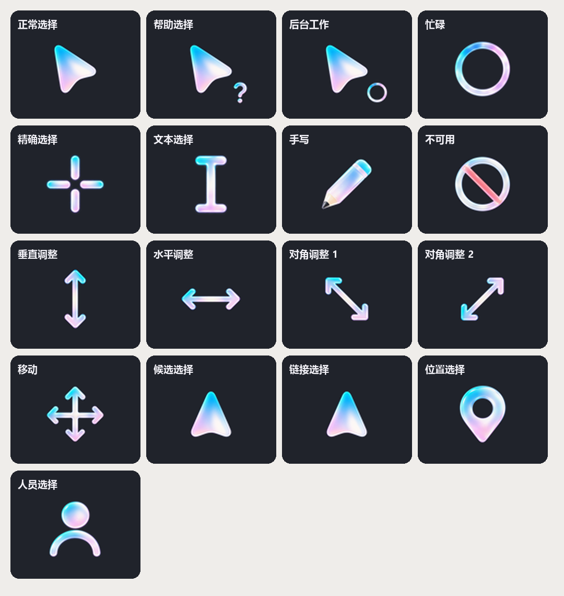

# Graphite Pearl Cursor

[English](README.md) | 简体中文

适用于 Windows 11 的珠光渐变光标主题，采用圆润轮廓和左偏 33° 的对称指针。



## 特性

- 17 个光标角色，包含两种动画状态；链接与候选选择使用相同的正向图形。
- 静态尺寸：32–128 px；动画尺寸：32、48、64 px。
- 为当前用户安装，支持备份和恢复。

## 安装

从 Releases 下载并解压 `Graphite-Pearl-Cursor-Windows.zip`。
从 Windows 打开 PowerShell，进入解压后的 `GraphitePearl` 目录，运行：

```powershell
.\Apply.ps1
```

无需管理员权限。脚本应用光标、同步当前桌面主题中的光标记录，并关闭“允许主题更改鼠标指针”。
保留已有指针大小设置。

安装文件和备份位于 `%LOCALAPPDATA%\GraphitePearl`。
恢复时，为 `Apply.ps1` 的 `-RestoreBackup` 参数传入安装结果中的 `BackupFile` 路径。
在不再需要恢复前，请保留备份和原光标文件。

## 构建与验证

需要 Windows、Python 3.10+ 和 Pillow。在仓库根目录依次运行：

```powershell
py -m pip install -r requirements.txt
```

```powershell
py .\source\build_pearl_theme.py
```

```powershell
py .\source\validate_pearl_theme.py
```

```powershell
.\source\test_pearl_theme_settings.ps1
```

输出：`package/GraphitePearl/` 和安装压缩包。
上述命令不会更改当前使用的光标。

## 许可证

代码与文档采用 [MIT](LICENSE)，图形素材采用 [CC BY 4.0](LICENSE-ASSETS.md)。
代码归属与素材来源见[相关说明](THIRD_PARTY_NOTICES.md)。
